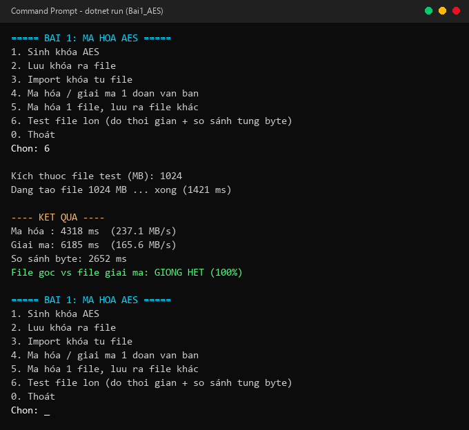

# BÁO CÁO BÀI TẬP: MÃ HOÁ AES & RSA

| Thông tin | Nội dung chi tiết |
|---|---|
| **Môn học** | An toàn và Bảo mật Thông tin |
| **Giảng viên hướng dẫn** | ThS. Đỗ Duy Cốp |
| **Sinh viên thực hiện** | **Nguyễn Văn Mạnh** |
| **Mã số sinh viên (MSSV)** | **K235480106082** |
| **Lớp** | **59KMT** |
| **Nền tảng phát triển** | C# (.NET 8 SDK) & Windows Forms Desktop |
| **Thư viện mật mã** | `System.Security.Cryptography` (chuẩn công nghiệp FIPS) |

---

## 1. Cấu trúc thư mục dự án

Toàn bộ bài làm được đóng gói độc lập trong thư mục **`rsa_aes`**, chia thành 2 đồ án con hoàn chỉnh:

```text
rsa_aes/
│
├── bai1_aes/                       ⭐ BÀI 1: MÃ HOÁ ĐỐI XỨNG AES-256
│   ├── Bai1_AES.csproj             - File cấu hình .NET 8 (Console Application)
│   ├── Program.cs                  - Toàn bộ mã nguồn C# AES-256
│   ├── Chay_Bai1_Dotnet.bat        - Phím tắt chạy nhanh C# Console
│   ├── README.md                   - Báo cáo khoa học chi tiết Bài 1
│   └── images/                     - Ảnh chụp màn hình thực tế Bài 1
│       ├── 01-sinh-khoa-luu-doc-khoa.png
│       ├── 02-ma-hoa-van-ban.png
│       └── 03-test-file-1gb.png
│
├── bai2_rsa/                       ⭐ BÀI 2: MÃ HOÁ BẤT ĐỐI XỨNG RSA & CHỮ KÝ SỐ
│   ├── Bai2_RSA.csproj             - File cấu hình .NET 8 (Windows Forms App)
│   ├── MainForm.cs                 - Giao diện Form & logic RSA, ASN.1, PSS
│   ├── Program.cs                  - Entry point khởi chạy Windows Forms
│   ├── Chay_Bai2_Dotnet_Form.bat   - Phím tắt chạy nhanh Windows Forms
│   ├── README.md                   - Báo cáo khoa học chi tiết Bài 2
│   └── images/                     - Ảnh chụp màn hình thực tế Bài 2
│       ├── 01-sinh-khoa-pem.png
│       ├── 02-xem-pem.png
│       ├── 03-ma-hoa-du-lieu.png
│       ├── 04-giai-ma-so-sanh.png
│       ├── 05-do-toc-do.png
│       ├── 06-bam-sha256.png
│       ├── 07-chu-ky-pkcs1v15.png
│       └── 08-chu-ky-pss.png
│
├── Chay_Bai1_AES.bat               🚀 Phím tắt mở ngay Bài 1 từ thư mục gốc
├── Chay_Bai2_RSA.bat               🚀 Phím tắt mở ngay Bài 2 từ thư mục gốc
└── README.md                       📄 Báo cáo tổng hợp toàn bộ bài tập
```

---

## 2. Hướng dẫn khởi chạy

Chỉ cần nhấp đúp trực tiếp vào 2 file kịch bản thực thi ở thư mục gốc:

- **Chạy Bài 1 (AES Console):** Nhấp đúp **`Chay_Bai1_AES.bat`**
- **Chạy Bài 2 (RSA Windows Forms):** Nhấp đúp **`Chay_Bai2_RSA.bat`**

---

## 3. Tóm tắt kết quả Bài 1: Mã hoá AES-256

*Chi tiết xem tại: [`bai1_aes/README.md`](bai1_aes/README.md)*

- **Thuật toán:** AES-256-CBC, đệm PKCS#7, IV ngẫu nhiên 16 bytes.
- **Xử lý file lớn:** Dùng cơ chế luồng `CryptoStream` đọc/ghi từng khối 1 MB, không chiếm dụng bộ nhớ RAM.
- **Kết quả thực nghiệm file 1024 MB (1 GB):**
  * Thời gian mã hoá: **4,594 ms (~222.9 MB/s)**
  * Thời gian giải mã: **6,341 ms (~161.5 MB/s)**
  * So sánh byte: **Trùng khớp 100% (lệch đúng 0 byte)**.



---

## 4. Tóm tắt kết quả Bài 2: Mã hoá RSA & Chữ ký số

*Chi tiết xem tại: [`bai2_rsa/README.md`](bai2_rsa/README.md)*

### 4.1. Giao diện Windows Forms
Ứng dụng Windows Forms chuyên nghiệp chia 2 cột: Cột trái gồm các nút điều khiển từ 1 đến 9, cột phải là màn hình Log kết quả:


### 4.2. Phân tích cấu trúc ASN.1 TLV
Giải mã định dạng PEM trích xuất các thành phần nhị phân DER: Modulus $n$ (2048 bit), Public Exponent $e = 65537$, Private Exponent $d$, các số nguyên tố $p, q$ và các hệ số CRT ($dP, dQ, qInv$):


### 4.3. Benchmark tốc độ: Public Key vs Private Key
Mã hoá bằng Public Key ($e=65537$ nhỏ) đạt **$\approx 0.0169\text{ ms/lần}$**, trong khi giải mã bằng Private Key ($d \approx 2048\text{ bit}$ lớn) mất **$\approx 0.5090\text{ ms/lần}$** (chậm hơn ~30 lần do thuật toán Square-and-Multiply phải tính toán nhiều phép nhân số lớn):


### 4.4. Băm SHA-256 & Hiệu ứng tuyết lở (Avalanche Effect)
Thay đổi chỉ 1 ký tự ở dữ liệu đầu vào làm đảo lộn ngẫu nhiên **130 / 256 bit ($\approx 50.78\%$)** của mã băm SHA-256:


### 4.5. Đề xuất phương pháp chữ ký số: RSA-PSS với Random Salt
- Chuẩn **PKCS#1 v1.5**: Ký nhiều lần cùng dữ liệu ra **chữ ký giống nhau** (tất định).
- **ĐỀ XUẤT CHUẨN RSA-PSS (RFC 3447)**: Nhúng chuỗi Salt ngẫu nhiên mỗi lần ký:
  * Cùng dữ liệu + cùng người ký $\rightarrow$ Mỗi lần ký sinh ra một chữ ký **hoàn toàn khác biệt**.
  * Public Key xác minh cả 2 lần đều **HỢP LỆ (PASS)**.
  * Ứng dụng thực tế: Chống tấn công phát lại (Replay Attack) trong giao dịch số.


---

## 5. Tổng kết đánh giá

| Tiêu chí | Bài 1 (AES-256) | Bài 2 (RSA-2048) |
|---|---|---|
| **Loại mã hoá** | Đối xứng (Symmetric) | Bất đối xứng (Asymmetric) |
| **Tốc độ xử lý** | Rất nhanh (~200 MB/s) | Rất chậm (~0.5 ms / 1 khối) |
| **Kích thước dữ liệu** | Không giới hạn (Hàng GB) | Bị giới hạn ($\le 190$ bytes) |
| **Ứng dụng chính** | Mã hoá dữ liệu lớn (File, Database) | Trao đổi khoá bí mật & Chữ ký số |
| **Mô hình kết hợp (Hybrid)** | Dùng AES mã hoá dữ liệu lớn $\longleftrightarrow$ Dùng RSA mã hoá khoá AES |

---

*Báo cáo thực hành môn An toàn và Bảo mật Thông tin — Sinh viên: **Nguyễn Văn Mạnh** (MSSV: **K235480106082** - Lớp: **59KMT**)*
