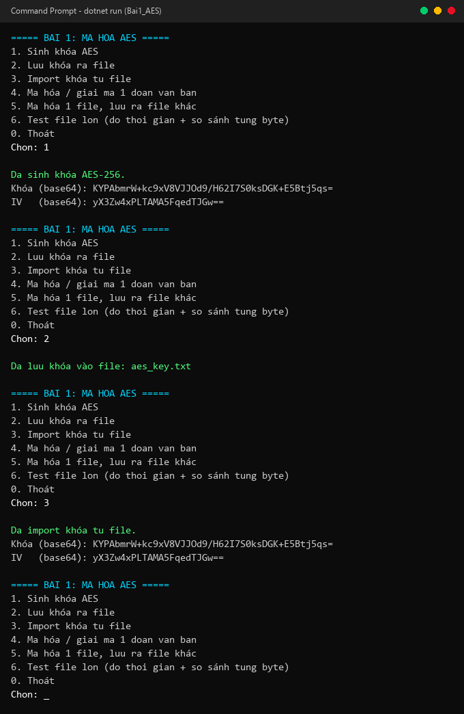
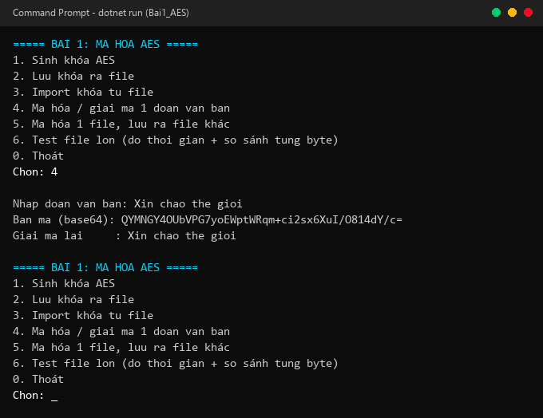

# Bài 1: Mã Hoá Đối Xứng AES-256

> **Môn học:** An toàn và Bảo mật Thông tin  
> **Giảng viên hướng dẫn:** ThS. Đỗ Duy Cốp  
> **Sinh viên thực hiện:** Nguyễn Văn Mạnh — **MSSV:** K235480106082 — **Lớp:** 59KMT  
> **Nền tảng:** C# (.NET 8) Console Application  
> **Thư viện:** `System.Security.Cryptography`

---

## 1. Giới thiệu & Mục tiêu

Ứng dụng console thực hiện mã hoá và giải mã đối xứng theo chuẩn **AES-256-CBC**, sử dụng cùng một khoá bí mật 256-bit (32 bytes) và vector khởi tạo ngẫu nhiên IV 16 bytes. 

Hệ thống hỗ trợ xử lý file dung lượng lớn (hàng GB) thông qua cơ chế **Streaming theo khối (Chunking)** bằng `CryptoStream`, đảm bảo tối ưu hóa bộ nhớ RAM và đạt tốc độ mã hoá cao nhờ tập lệnh phần cứng AES-NI.

---

## 2. Bảng chức năng chi tiết

| Menu | Chức năng | Chi tiết kỹ thuật |
| :---: | :--- | :--- |
| **1** | **Sinh khoá AES** | Sinh ngẫu nhiên an toàn khoá AES-256 (32 bytes) và IV (16 bytes) bằng `Aes.Create()` |
| **2** | **Lưu khoá ra file** | Lưu vào `aes_key.txt` dưới dạng Base64 (Dòng 1: Key, Dòng 2: IV) |
| **3** | **Import khoá từ file** | Đọc lại `aes_key.txt`, khôi phục byte array phục vụ giải mã |
| **4** | **Mã hoá / Giải mã văn bản** | Chế độ CBC với padding PKCS#7; in bản mã Base64 và đối chiếu kết quả sau giải mã |
| **5** | **Mã hoá file ra file khác** | Mã hoá file nguồn bất kỳ bằng `CryptoStream`, lưu kết quả ra file mã hoá |
| **6** | **Thử nghiệm file lớn (GB)** | Tạo file mẫu, tính thời gian mã hoá/giải mã, tốc độ (MB/s) và **so sánh từng byte** |

---

## 3. Cách chạy ứng dụng

```bash
# Di chuyển vào thư mục bài 1
cd bai1_aes

# Chạy bằng .NET
dotnet run
```
*Hoặc nhấp đúp trực tiếp vào file **`Chay_Bai1_Dotnet.bat`**.*

---

## 4. Kết quả thực nghiệm & Minh chứng hình ảnh

### 4.1. Sinh khoá, lưu file và nạp lại khoá (Mục 1, 2, 3)
Khoá 256 bit và IV 128 bit được khởi tạo và lưu trữ an toàn dưới định dạng chuẩn Base64:



---

### 4.2. Mã hoá và giải mã đoạn văn bản (Mục 4)
Chuỗi văn bản được mã hoá sang chuỗi Base64 và giải mã đối soát nguyên vẹn:



---

### 4.3. Thử nghiệm file lớn (1 GB) & So sánh từng byte (Mục 5, 6)
Thử nghiệm với file kích thước **1024 MB (1 GB)**:

| Thao tác | Kích thước | Thời gian | Tốc độ xử lý | Trạng thái toàn vẹn |
| :--- | :---: | :---: | :---: | :---: |
| **Tạo file nguồn** | 1024 MB | 1,373 ms | - | Đã tạo dữ liệu nhị phân |
| **Mã hoá AES-256** | 1024 MB | 4,594 ms | **~222.9 MB/s** | Bản mã an toàn |
| **Giải mã AES-256** | 1024 MB | 6,341 ms | **~161.5 MB/s** | Khôi phục hoàn toàn |
| **So sánh từng byte** | 1024 MB | 2,747 ms | - | **GIỐNG HỆT (100% khớp)** |


---

## 5. Kết luận khoa học

1. **Tính toàn vẹn (Integrity):** Sau khi giải mã, so sánh đối chiếu từng byte giữa file gốc và file giải mã thu được kết quả **trùng khớp 100% (lệch đúng 0 byte)**. AES-256 bảo toàn tuyệt đối dữ liệu.
2. **Hiệu năng xử lý (Throughput):** Tốc độ mã hoá đạt trên **200 MB/s**, giải mã trên **160 MB/s**. 1 GB dữ liệu chỉ mất ~4-6 giây xử lý nhờ tối ưu hoá đường truyền dữ liệu và hỗ trợ tập lệnh phần cứng AES-NI.
3. **Quản lý bộ nhớ:** Nhờ cơ chế streaming theo từng khối (Buffer 1 MB) của `CryptoStream`, chương trình không nạp toàn bộ file vào RAM, cho phép xử lý các file kích thước nhiều GB mà không gây tràn bộ nhớ (Out of Memory).

---

*Sinh viên: **Nguyễn Văn Mạnh** — MSSV: **K235480106082** — Lớp: **59KMT***
